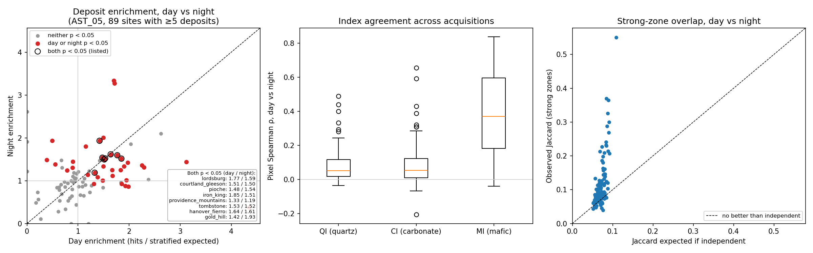
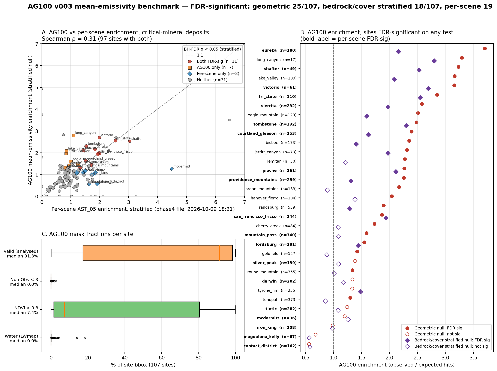
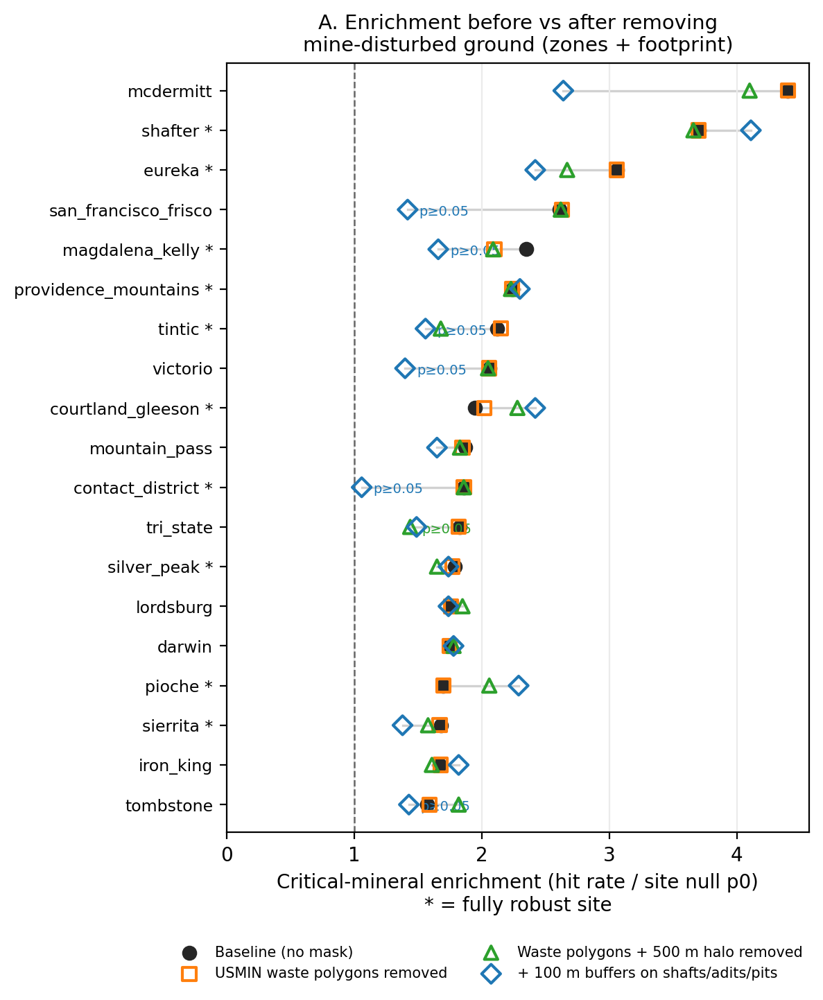
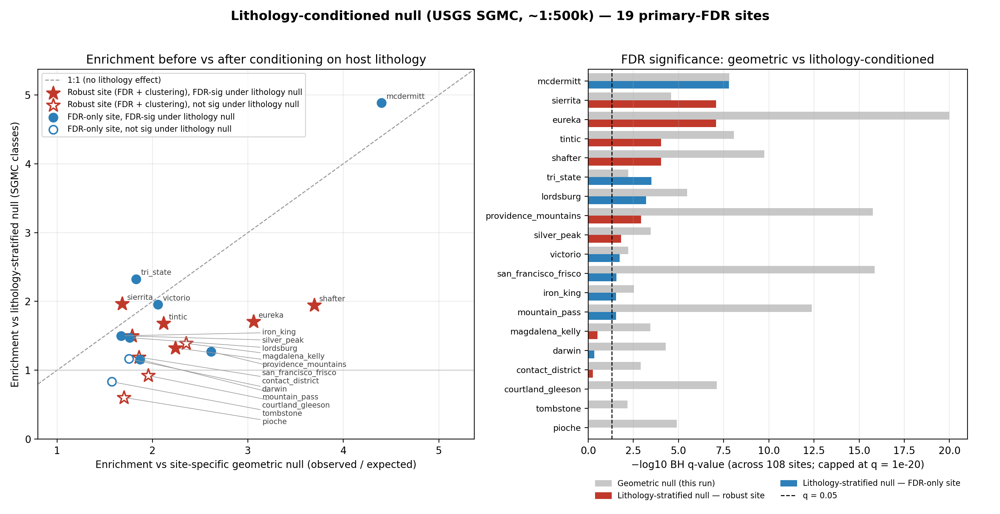
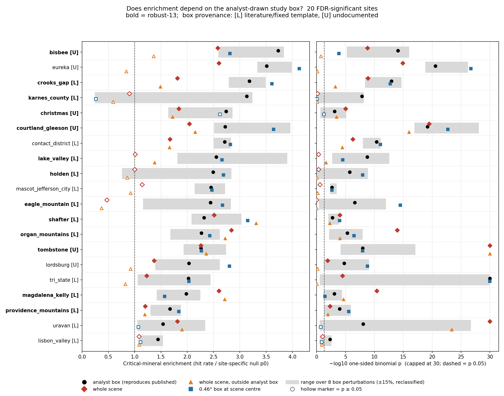

# Data validation and verification

How this project checks the legacy and third-party data it relies on, following the CIM
*Mineral Exploration Best Practice Guidelines* (2018), §2.1.1.1:

> *Data validation* … includes all the checks done to make sure there are no errors or mismatches
> in the data (e.g., overlapping samples, mislabelling of data, mixed units, etc.) … *Data
> verification* is related to the integrity and accuracy of the data to represent results that are
> reasonable … the current operator must audit the legacy data in order to accept responsibility
> for its use … These verification activities should be thoroughly described and documented.

CIM is written for property-scale exploration programs. This project is a 109-site desk study, so
physical checks such as re-sampling showings or twinning holes are replaced by desk-based
equivalents. **No field verification was done**, and nothing here should be read as if it were.

## 1. Inputs and their custody

| Input | Source | Role | Custody record |
|---|---|---|---|
| MRDS (304,632 records) | USGS mrdata.usgs.gov, `data/mrds.csv` + `data/mrds.met` | Validation target (deposit locations, commodity, type) | SHA-256 in every `results/{id}_provenance.json` (`inputs.mrds_sha256`) and `data/MANIFEST.sha256` |
| ASTER AST_05 v004 TES emissivity B10–B14 + QA (day; night for replication) | NASA LP DAAC via `earthaccess` | Primary measurement | Product, granules, QA rule and mask fractions in `{site}_mosaic_granules.json`, copied into provenance (`inputs.aster_product`, `inputs.mosaic_selection`) |
| ASTER L1T v004 TIR radiance | NASA LP DAAC | Legacy input (§2.4); GEE parity | Archived in `aster_l1t_day/` and `aster_archive_pre_clearday/` |
| AG100 v003 (ASTER GED) | NASA LP DAAC | Water/vegetation masks; benchmark | `data/ag100/` tile cache |
| SGMC geology | USGS (Horton et al. 2017) | Bedrock/cover strata for the primary null | `data/lithology/` cache |
| Fault layers | USGS Quaternary Faults, SGMC | Structure annotation | `inputs.structure_source` in provenance; files in manifest |
| GEMx AVIRIS-5 L2A reflectance | ORNL DAAC | Independent sensor at 3 sites | Files in manifest |
| Esri World Imagery | contextily | Figure backdrop only (never analysed) | Attribution printed on every figure 03 |

`scripts/write_data_manifest.py` writes `data/MANIFEST.sha256` (333 files, 80.2 GB of raw inputs);
`--check` re-verifies them. Each provenance file also records the site-config hash, the
classification parameters and the git commit, so any result can be tied to exact inputs and code.

**Coordinate system.** MRDS coordinates are WGS84 (`data/mrds.met`, `Horizontal_Datum_Name`), so no
datum shift is needed. All distance and area operations use each site's local UTM zone.

## 2. Validation (errors, duplicates, mislabelling)

### 2.1 MRDS record validation — `validate_mrds()` in `src/critical_minerals_aster/mrds.py`

Applied automatically by `read_mrds_national()`, which every analysis script uses. Hard exclusions:

| Rule | CIM category | National count |
|---|---|---|
| Missing / non-numeric coordinates | error | 19 |
| Coordinates out of range | error | 0 |
| `dev_stat == "Plant"` (mill, smelter, processing plant — not a deposit) | mislabelling | 3,008 |
| Same site name at identical coordinates (keep best `score`, then most advanced `dev_stat`) | duplicate | 2,217 |
| **Retained** | | **299,388 of 304,632** |

Flags kept for sensitivity analysis: `qc_score_high` (USGS record grade A–C), `qc_producer`
(Producer / Past Producer) and `qc_shared_coords` (21,180 records share exact coordinates with a
differently named record; these are handled statistically by DBSCAN declustering, not dropped).

Inside the 109 site footprints, validation removed 330 of 30,170 records (1.1%; 156 plants, 174
duplicates; per-site counts in `results/mrds_validation_report.csv`).

**Effect on headline results** (`scripts/compare_validation_baseline.py` →
`results/validation_baseline_diff.csv`; raw-MRDS snapshot in `results/_baseline_pre_validation/`):

| Result | Raw MRDS | Validated MRDS |
|---|---|---|
| Critical-mineral records across sites | 18,804 | 18,562 |
| FDR-significant, binomial | 20 | 20 |
| FDR-significant, Mann–Whitney | 31 | 31 (`lemitar` in, `getchell` out) |
| Fully robust | 13 | 13 (same sites) |
| Skarn/CRD median enrichment | 1.64× (1.02–2.25) | 1.64× (1.03–2.26) |
| Discovery era, post-1950 | 0.92×, p = 0.73 | 0.95×, p = 0.66 |

Getchell lost 8 critical records, 6 of them processing plants; its continuous-score significance
partly rested on mill sites.

### 2.2 Silent-failure removal

The deposit-to-footprint clip previously fell back to the bbox silently on geometry errors
(`except Exception: pass`) in `metrics.compute_site_summary`, `pipeline.run_site` and
`scripts/regenerate_site_summaries.py`. It now warns. The 109-site regeneration produced no such
warnings.

### 2.3 Hand-entered deposit categories — `scripts/check_deposit_categories.py`

`results/deposit_system_categories.csv` is structurally valid (109 sites, one row each, allowed
categories, confidence and basis filled). As an independent check, each hand category was compared
with the mineral systems MRDS assigns from its `model` and `dep_type` fields (commodity fallback
excluded): 54 consistent, 40 flagged, 15 with too few typed records
(`results/deposit_category_review.csv`). 28 of the 40 flags come from one classifier rule
(`dep_type` containing "vein" maps to Orogenic), so the automated field cannot replace a second
geologist. **Open action:** a blind second-geologist review of the 40 flagged sites.

### 2.4 ASTER cloud contamination — `scripts/audit_granule_cloud_cover.py`, `scripts/cloud_sensitivity.py`

Granule selection originally ranked scenes on bbox coverage and band count only, with no cloud
check. The audit (`results/granule_cloud_audit.csv`, 780 site–granule rows) pulled CMR cloud
metadata for every granule behind each site. For the 73 mosaic sites whose source granules were no
longer on disk, the granule lists were rebuilt by replaying the pipeline's search. 104 of 105
rebuilt mosaic extents match the surviving mosaic to within 0.05°. Bbox cloud is estimated from
ASTER quadrant cloud values and blended by each granule's bbox coverage.

| Blended bbox cloud | Sites | Of the 20 FDR-significant |
|---|---|---|
| < 10% (`ok`) | 25 | 4 |
| 10–30% (`review`) | 33 | 8 |
| > 30% (`high`) | 51 | 8 |

**Does cloud drive the signal?** Across sites there is no association: Spearman ρ(cloud,
enrichment) = −0.11, p = 0.25. The median cloud of FDR-significant sites is 27%, against 30% for
the rest (Mann–Whitney p = 0.78). Re-applying BH-FDR within the 58 sites under 30% cloud leaves 12
FDR-significant sites, including 10 of the 13 robust sites. Seven of the nine arid skarn/CRD robust
sites are under 30% cloud.

**Site-level concerns** (visual check of the ratio and classification figures; `visual_check`
column):

- **Likely affected:** `tri_state`, `mascot_jefferson_city`, `magdalena_kelly`, `eureka`. Their
  figures show round, sharp-edged or lobed shapes, and some of these fall inside strong-anomaly
  zones. `magdalena_kelly` (51% cloud) is in the robust set, so its robust status is provisional.
- **Robust but cloudy:** `lake_valley` (51%) and `holden` (72%, alpine March–June scenes, so some
  of the "cloud" may be snow). This is a further reason to treat `holden` as unresolved.
- `goldfield` is a single February 2010 night granule with 100% scene cloud. The GEMx Goldfield
  TIR-versus-SWIR correspondence (Jaccard 0.075) should be re-run on a clear granule before it is
  interpreted.

**Root cause.** The mosaic search requested only the first 20 CMR results (10 for single granules),
in catalogue order, and then feather-blended *every* overlapping granule. 295 of the 780 granules
were night scenes, and many mosaics mixed day and night. Radiance ratios shift by about 2.5%
(B13/B14) to 7–8% (B13/B12) over a 30 K day–night temperature difference
(`docs/cloud_night_methods_review.md`). No published ASTER lithology mosaic mixes day and night.

**Fix (decision: clear sky and daytime first).** `spectral.select_mosaic_granules` searches up to
500 granules and picks a small single-tier set, reference granule first. The tier order is:

1. clear day (≤ 30% scene cloud);
2. clear night;
3. cloudy day;
4. cloudy night.

Day and night are never mixed. Within each tier, May–September scenes are tried before other
months, following the Nevada ASTER TIR precedent (Rockwell & Hofstra 2008). If no tier reaches 90%
bbox coverage, the earliest tier within 5 points of the best is kept, so that swath-edge sites
stay on day scenes.

Each mosaic writes `{site}_mosaic_granules.json` (granule, cloud, day/night, month, coverage), and
provenance records it. TIR band files are kept, so the ratio recipe can change without
re-downloading. The plan (`results/clear_day_mosaic_plan.csv`, from
`scripts/rebuild_clear_day_mosaics.py`) finds a clear-day, May–September set for **all 109 sites**:

- 1–2 granules per site, 139 in total;
- ≥ 97% bbox coverage at every site except Elk Creek and Ambrosia Lake (84%), which sit on a
  swath edge;
- median scene cloud 0%, with 99 of 109 sites under 10%; the highest is Carlin Trend (29%).

The four YAML-pinned sites (goldfield, yerington, mcdermitt, silver_peak) were unpinned. The old
ASTER files are kept in `data/sites/{id}/aster_archive_pre_clearday/`, and results before the
rebuild in `results/_baseline_pre_clearday/`.

**Result of the rebuild: the signal does not survive a change of acquisition.** All 109 sites
rebuilt, and the analysis chain was re-run on them.

- **FDR-binomial sites fall from 20 to 4.** Tri-State and Mascot-Jefferson City are kept;
  Josephine and Pea Ridge are new.
- **Mann–Whitney sites fall from 31 to 9.**
- **Median enrichment across all 109 sites falls from 0.96× to 0.50×.** Deposits now tend to *avoid*
  zones (Bisbee 0.16×, Courtland–Gleeson 0.16×, Magdalena–Kelly 0.17×).
- **The null is unchanged** (median p0 0.115 before, 0.116 after), and deposit counts change only
  where the footprint changed. So this is not a zone/footprint bug.

**Why.** Radiance ratios without temperature normalisation track surface temperature. In the
summer-day mosaics, the "silica" ratio (B13/B14) correlates with B10 radiance at Spearman ρ =
0.47–0.71 across six test sites, against 0.19–0.52 in the old night/mixed mosaics. The percentile
zones therefore pick out the hottest terrain (basin floors, sun-facing slopes), while deposits sit
in cooler bedrock ranges.

**Implications.**

- **The pre-rebuild headline (20 FDR / 13 robust) depended on which scenes were chosen**, and those
  were largely night or mixed scenes. The "field duplicate" QA/QC analogue (§4) has now been done
  in effect, and it fails for raw radiance ratios.
- **The method needs a temperature-independent input** before any site-level claim is made. This
  was done in §2.5.
- Pre-rebuild results are in `results/_baseline_pre_clearday/`, and old ASTER files in
  `data/sites/*/aster_archive_pre_clearday/`. Radiance clear-day results are in
  `results/_baseline_pre_emissivity/`, and their files in `data/sites/*/aster_l1t_day/`.

### 2.5 Emissivity input and the other best-practice corrections

All 109 sites were rebuilt with the following changes (`scripts/rebuild_emissivity_mosaics.py`,
`pipeline.download_and_mosaic_ast05`). Sources are in `docs/cloud_night_methods_review.md`.

| Correction | Implementation |
|---|---|
| Temperature-independent input | `AST_05` v004 TES surface emissivity (B10–B14) instead of L1T radiance |
| Daytime, clear, warm season | Clear-sky (≤ 30% scene cloud) day granules, May–September first, never mixed with night. All 109 sites: 193 granules, all May–Sep, 100% planned bbox coverage |
| Per-pixel cloud / bad-data mask | `QA_DataPlane`: quality = good, cloud = clear, cloud adjacency ≤ 1; every band in [0.5, 1.0] |
| QA-aware selection | A granule whose QA-good pixels cover < 50% of its bbox footprint is dropped and the selection redone (up to 4 builds; best kept). Scene-level cloud cover misses these: Bisbee's night scene was "0% cloud" but 99.9% QA-rejected |
| Correct index definitions | Ninomiya QI = B11²/(B10·B12), CI = B13/B14, MI = B12/B13 (`spectral.alteration_indices`), in the legacy `silica` / `carbonate` / `mafic` slots. Removes the mislabelled "silica" layer and the reciprocal pair (§6) |
| No blending across scenes | Indices are computed per granule and priority-stacked onto a 90 m bbox grid. The reference granule wins; later granules only fill gaps, after mean/std matching on the overlap |
| Water and vegetation masks | AG100 v003 land/water map and mean NDVI > 0.3 (`ag100.py`) are removed before classification. Masked pixels leave the valid footprint, so they also leave the null |
| Bedrock-vs-cover null as primary | `site_specific_null_significance.py`: each deposit's null probability is the zone coverage of its own stratum (SGMC "Unconsolidated" = cover; unmapped separate); exact Poisson-binomial p. The geometric null is kept as `*_geometric` |
| Independent replication | Night AST_05 mosaics (`aster_night/`) and the AG100 multi-year mean emissivity, both outside the score (§2.6) |

Day mosaics: median 97.9% of the bbox QA-valid before masks. Only Duluth–South Kawishiwi (53%)
and Tilly Foster (80%) are lower, both humid eastern sites. Vegetation masking matters mostly in
the east (§2.6). The QI maps show faint cross-track detector striping, inherited from B10/B11
emissivity (e.g. `figures/sites/pioche/01_tir_band_ratios.png`). No destriping was applied.

**Result** (`results/phase4_fdr_corrected_significance.csv`, 108 testable sites):

| Input | FDR-binomial sites | Median enrichment |
|---|---|---|
| Original mixed day/night radiance, geometric null | 20 | 0.96× |
| Clear-day radiance, geometric null | 4 | 0.50× |
| Clear-day emissivity, geometric null | 23 | 1.13× |
| **Clear-day emissivity, bedrock/cover null (primary)** | **19** | **1.03×** |

So the collapse in §2.4 was a temperature artefact of radiance ratios, and emissivity removes it.
The site list did change, though. Of the original 20, nine stay significant (contact_district,
courtland_gleeson, eureka, lordsburg, magdalena_kelly, providence_mountains, shafter, tombstone,
tri_state). Ten are new: darwin, iron_king, mcdermitt, mountain_pass, pioche,
san_francisco_frisco, sierrita, silver_peak, tintic and victorio. Eleven drop out: bisbee,
christmas, crooks_gap, eagle_mountain, holden, karnes_county, lake_valley, lisbon_valley,
mascot_jefferson_city, organ_mountains and uravan. The stratified null removes bisbee, goldfield,
round_mountain and tonopah from the geometric list and adds none. Ten of the 19 are also
significant at every declustering radius (Phase 5).

### 2.6 Field-duplicate analogues: night replication and AG100 benchmark

**Night AST_05** (`scripts/day_night_replication.py`, `results/day_night_replication.csv`). Each
site also has a clear night emissivity mosaic, built the same way (107 clear, 2 cloudy-tier; median
97.7% QA-valid). Night QI/CI/MI are resampled onto the day grid. Both acquisitions are then
classified on the pixels they share (median 95% of the day footprint), and the same stratified
null is evaluated on rasters.

- **Pixel agreement is low for QI and CI and moderate for MI** (median Spearman ρ 0.05, 0.05, 0.37).
  This is not misregistration: at the desert sites B10 emissivity agrees at ρ 0.7–0.9 after a
  5×5 smoothing, and the indices rise to 0.4–0.9. TES noise at 90 m swamps the ~1% QI and CI
  contrasts pixel by pixel, while the spatial pattern is shared. Bisbee and McDermitt are
  exceptions where even B10 does not agree.
- **Strong zones overlap more than chance** at 80% of sites, but only modestly (median Jaccard 0.09
  vs 0.07 if independent).
- **Site enrichment agrees** (Spearman ρ 0.35, p < 0.001, 89 sites with ≥ 5 deposits; medians
  1.08× day vs 1.05× night). Of the 19 primary sites, 15 are also > 1× at night. Six are
  significant at night (p < 0.05): lordsburg, pioche, courtland_gleeson, tombstone, iron_king and
  providence_mountains. McDermitt is the clearest non-replication (4.5× day, 0.38× night).

**AG100 v003** (`scripts/ag100_benchmark.py`, `results/ag100_benchmark.csv`). The same indices,
percentiles and stratified null, applied to the ASTER GED 100 m mean emissivity (every clear
scene 2000–2008, cloud-free by construction):

- 18 sites FDR-significant (stratified), 25 under the geometric null.
- 11 of the 19 per-scene primary sites are also AG100-significant: courtland_gleeson, eureka,
  lordsburg, pioche, providence_mountains, san_francisco_frisco, shafter, sierrita, tombstone,
  tri_state and victorio. Per-site enrichment correlates at ρ 0.31 (p = 0.002, 97 sites;
  ρ 0.35 for the 90 sites with ≥ 5 deposits). Against the
  clear-day *radiance* results it was ρ 0.03.
- AG100 masks: vegetation is the one that matters (median 7%, but > 50% at 31 mostly eastern
  sites); water median 0%.

**Primary sites against the three independent checks** (clustering-robust, night p < 0.05,
AG100 FDR):

| Checks passed | Sites |
|---|---|
| 3 | courtland_gleeson, pioche, providence_mountains |
| 2 | eureka, lordsburg, shafter, sierrita, tombstone |
| 1 | contact_district, iron_king, magdalena_kelly, san_francisco_frisco, silver_peak, tintic, tri_state, victorio |
| 0 | darwin, mcdermitt, mountain_pass |

These are acquisition checks. The data-verification tests in §3 add lithology, mine-waste and
record-quality checks. The combined table (§3.5a) leaves Providence Mountains as the only site that
passes everything; Courtland-Gleeson and Pioche fail the 8-class lithology null.

## 3. Verification (is the legacy data accurate enough to trust?)

### 3.1 Record quality — `scripts/mrds_quality_sensitivity.py`

*Emissivity rerun, 2026-10-09.* The critical-mineral test was re-run on quality subsets with BH-FDR
inside each subset, using each site's primary (stratified) p0 (`results/mrds_quality_sensitivity.csv`):

| Subset | FDR-significant sites |
|---|---|
| All validated records | 19 (reproduces the primary set) |
| Record grade A–C | 13 |
| Producers / past producers | 22 |
| Grade A–C and producer | 15 |
| Records with unique coordinates | 19 (none lost) |

- **Sites lost on A–C records** are courtland_gleeson, pioche, silver_peak, tombstone, tri_state and
  victorio. This is mostly lost power: enrichment stays at 1.3–1.7× on half the records, and
  Tri-State has no A–C critical records at all.
- **Victorio is the exception.** Its enrichment falls from 1.99× to 1.43× on A–C records and to 1.31×
  on A–C producers.
- **Pioche weakens among producers** (1.22×, p = 0.11).
- **The highest-quality records strengthen some sites:** Providence Mountains goes from 1.32× to 1.89×
  on A–C records.

Overall, low-quality records are not generating the survey-level signal.

The p0 here is each site's aggregate stratified p0, applied to every subset. Subsets that shift
deposits between bedrock and cover make this approximate.

### 3.2 Location accuracy

- `scripts/mrds_location_sensitivity.py`: hit rates with 0–1000 m buffers around each deposit.
- `scripts/phase5_clustering_sensitivity.py`: DBSCAN declustering at 250/500/1000 m. On emissivity
  it keeps 10 of the 19 FDR sites; the 9 that drop out include darwin, lordsburg, mcdermitt,
  mountain_pass, tombstone and tri_state.

### 3.3 MRDS record audit against USMIN — `scripts/mrds_record_audit.py`

This check asks whether each MRDS record in the 19 FDR-significant sites has a mapped mine feature
nearby. The reference is USGS USMIN: shafts, adits, pits, prospects and waste polygons digitised from
1886–2006 topographic maps, converted from NAD27 to WGS84. The audit covers a stratified random
sample of 380 records and the full census of 3,697 critical-mineral records
(`results/mrds_audit.csv`, `results/mrds_audit_summary.csv`). Rerun on emissivity zones,
2026-10-09.

| Distance to nearest USMIN feature | Sample | Census |
|---|---|---|
| ≤ 250 m | 71.3% | 72.9% |
| ≤ 500 m | 79.5% | 82.0% |
| ≤ 1 km | 87.9% | 89.6% |

Within 250 m, 82.8% of grade A–C records verify, against 66.3% of grade D–E.

- **Hits are slightly better located than misses.** At 250 m, 76.8% of hits verify against 71.2% of
  misses (census; site-stratified CMH OR 1.47, p < 1e-5). The gap widens at 1 km (OR 2.11). Poor
  MRDS locations therefore dilute the signal rather than create it.
- **USMIN-corroborated subset.** Keeping only records within 250 m of a USMIN feature, all 19 sites
  stay significant at p < 0.05. Enrichment rises at 14 of them (for example mcdermitt 4.40× → 6.20×,
  victorio 2.06× → 2.65×).
- **Limitation.** USMIN coverage is uneven: 5 of 20 quads at Shafter, 18 of 19 at Tri-State. A quad
  with no features may simply have no mines. These audit enrichments use the geometric p0.

### 3.4 Mine-disturbed ground — `scripts/disturbed_ground_sensitivity.py`

The concern is that tailings, dumps and pits are spectrally distinct and sit exactly on deposits,
so they could produce hits without any natural alteration. Waste polygons (USMIN, plus
OpenStreetMap mine and quarry outlines as a supplement) are cut out of both the zones and the
footprint, and each site is re-tested (`results/disturbed_ground_sensitivity.csv`). The emissivity
rerun covers the 19 FDR sites, with the geometric null as the baseline:

| Variant | FDR sites losing significance (p ≥ 0.05) |
|---|---|
| Waste polygons removed | none |
| Waste + 500 m halo removed | tri_state (1.44×, p = 0.10) |
| + 100 m around every shaft/adit/pit | contact_district (1.06×), victorio, tombstone, san_francisco_frisco, tintic, magdalena_kelly (1.40–1.66×, p = 0.09–0.23); sierrita borderline with OSM added |

- **Waste covers little zone area:** under 1% at 17 of 19 sites. The exceptions are tri_state
  (3.8%; chat piles) and sierrita (3.2%; tailings impoundments).
- **The carbonate-replacement districts do not lean on dumps.** At courtland_gleeson, pioche and
  providence_mountains, enrichment *rises* once waste plus a 500 m halo is removed (to 2.28×,
  2.06× and 2.23×).
- **The point-buffer variant removes many deposits themselves** (contact_district goes from 164 to
  48), so it tests "deposits away from any working" rather than contamination. Read it as an upper
  bound on the disturbance effect.
- **Eureka** weakens from 3.06× to 1.93× under a 1 km halo, but stays significant (p < 0.001).

### 3.5 Lithology-conditioned null — `scripts/lithology_matched_null.py`

The geometric null (p0 = zone area / footprint area) assumes deposits could fall anywhere in the
footprint. But the TIR silica and carbonate ratios respond to rock type, and deposits cluster in
favourable host rocks. So zones and deposits can overlap because both follow the same exposed
units, not because the zones detect alteration.

The lithology-stratified null takes host rock from the USGS SGMC map compilation (Horton et al.
2017, doi:10.5066/F7WH2N65; 1:500k–1:1M). Its 33 `GENERALIZED_LITH` values are grouped into 8
classes. Each deposit's expected hit probability becomes the zone coverage *within its own class*,
and the test is a Poisson-binomial tail with BH-FDR across the 108 testable sites. A finer version
uses individual map units as strata. The unconditioned n, hits and p0 reproduce the phase-4
geometric columns.

This is a finer version of the primary null. The primary null (§2.5) uses only two SGMC strata,
bedrock and cover; this one uses 8 classes.

**Result (emissivity rerun, 2026-10-09).** 13 of the 19 primary sites stay FDR-significant under
the 8-class null; 9 survive the map-unit version. No site outside the primary 19 becomes
significant. **6 of the 10 clustering-robust sites survive:** eureka, providence_mountains, shafter,
sierrita, silver_peak and tintic.

| Group | Sites | Reading |
|---|---|---|
| Survive | mcdermitt (4.9×), sierrita (2.0×), victorio (2.0×), shafter (1.9×), eureka (1.7×), tintic (1.7×), tri_state (2.3×), lordsburg, iron_king, silver_peak, providence_mountains (1.33×), san_francisco_frisco, mountain_pass | Signal beyond host-rock class |
| Weaken below significance | magdalena_kelly (1.39×), contact_district (1.19×), darwin (1.17×) | Partly host-rock |
| Collapse to ≤ 1× | courtland_gleeson (0.92×), tombstone (0.83×), pioche (0.61×) | Zone–deposit overlap is explained by the shared host units |

The three collapses are all carbonate-replacement districts in sedimentary hosts. Two of them,
courtland_gleeson and pioche, pass the night and AG100 replications, so their zones are real and
repeatable. What they track is the carbonate host package rather than anything beyond it.

**How to read the collapse.** This test is conservative for skarn/CRD districts:

- At 1:1M, a mapped carbonate outcrop can essentially *be* the district, so conditioning on it can
  absorb real alteration signal.
- The carbonate and silica ratios are lithology-sensitive by design.

So the test cannot separate "the ratio detects the host rock" from "the ratio detects alteration of
the host rock". The defensible claim for these districts is weaker: ASTER TIR zones pick out the
host-rock packages that contain the deposits, which is useful for regional targeting, not evidence
of alteration mapping. Resolving the question needs finer-scale geology (1:24k–1:100k) or SWIR
mineral identification (GEMx).

**Other notes.**

- The host-restricted variant is uninformative: almost every class holds at least one deposit.
- Bisbee (16%) and Patagonia (17%) extend into Mexico, which SGMC doesn't cover; neither is in the
  primary 19.
- duluth_south_kawishiwi has no critical-mineral deposits and is skipped.

### 3.5a Cross-check of the 19 primary sites against every test

Columns:

- **Primary E:** enrichment under the stratified null.
- **Clustering:** significant at every DBSCAN radius.
- **Night:** night AST_05, p < 0.05.
- **AG100:** stratified FDR.
- **Lithology:** 8-class SGMC, FDR.
- **Waste + 500 m:** USMIN waste plus a 500 m halo removed, p < 0.05.
- **A–C records:** FDR on grade A–C MRDS records.

The point-buffer variant (§3.4) is listed separately, because it removes deposits rather than
contamination.

| Site | Primary E | Clustering | Night | AG100 | Lithology | Waste + 500 m | A–C records | Passed | 100 m point buffers |
|---|---|---|---|---|---|---|---|---|---|
| providence_mountains | 1.32× | ✓ | ✓ | ✓ | ✓ | ✓ | ✓ | 6/6 | ✓ |
| shafter | 3.04× | ✓ | ✗ | ✓ | ✓ | ✓ | ✓ | 5/6 | ✓ |
| sierrita | 1.99× | ✓ | ✗ | ✓ | ✓ | ✓ | ✓ | 5/6 | ✓ |
| eureka | 1.84× | ✓ | ✗ | ✓ | ✓ | ✓ | ✓ | 5/6 | ✓ |
| lordsburg | 1.72× | ✗ | ✓ | ✓ | ✓ | ✓ | ✓ | 5/6 | ✓ |
| courtland_gleeson | 1.52× | ✓ | ✓ | ✓ | ✗ | ✓ | ✗ | 4/6 | ✓ |
| pioche | 1.44× | ✓ | ✓ | ✓ | ✗ | ✓ | ✗ | 4/6 | ✓ |
| san_francisco_frisco | 1.94× | ✗ | ✗ | ✓ | ✓ | ✓ | ✓ | 4/6 | ✗ |
| tintic | 1.85× | ✓ | ✗ | ✗ | ✓ | ✓ | ✓ | 4/6 | ✗ |
| iron_king | 1.73× | ✗ | ✓ | ✗ | ✓ | ✓ | ✓ | 4/6 | ✓ |
| tombstone | 1.54× | ✗ | ✓ | ✓ | ✗ | ✓ | ✗ | 3/6 | ✗ |
| victorio | 1.99× | ✗ | ✗ | ✓ | ✓ | ✓ | ✗ | 3/6 | ✗ |
| contact_district | 1.92× | ✓ | ✗ | ✗ | ✗ | ✓ | ✓ | 3/6 | ✗ |
| magdalena_kelly | 1.64× | ✓ | ✗ | ✗ | ✗ | ✓ | ✓ | 3/6 | ✗ |
| silver_peak | 1.43× | ✓ | ✗ | ✗ | ✓ | ✓ | ✗ | 3/6 | ✓ |
| mcdermitt | 4.49× | ✗ | ✗ | ✗ | ✓ | ✓ | ✓ | 3/6 | ✓ |
| mountain_pass | 1.21× | ✗ | ✗ | ✗ | ✓ | ✓ | ✓ | 3/6 | ✓ |
| tri_state | 2.55× | ✗ | ✗ | ✓ | ✓ | ✗ | ✗ | 2/6 | ✓ |
| darwin | 1.50× | ✗ | ✗ | ✗ | ✗ | ✓ | ✓ | 2/6 | ✓ |

How to read the table:

- **Providence Mountains passes every test.**
- **Shafter, Sierrita, Eureka and Lordsburg** each miss one, either the night scene or clustering.
- **Courtland-Gleeson and Pioche** replicate across acquisitions but collapse under the lithology
  null. Their zones are repeatable host-package maps, not evidence of alteration beyond the host.
- **McDermitt** is the strongest single-scene result (4.49×), but it fails all three replication
  checks. Treat it as acquisition-specific.
- **Two A–C failures are a lack of data rather than a weaker effect.** Tri_state has no A–C records,
  and courtland_gleeson's enrichment holds at 1.45× on A–C records.
### 3.6 Study-box independence — `scripts/bbox_independence_sensitivity.py`

> **Legacy (radiance era).** This check ran on the L1T radiance-ratio mosaics and the 20-site
> radiance FDR set. It has not been ported to the emissivity mosaics: the AST_05 build writes
> bbox-clipped products, so there is no whole-scene raster to re-threshold (§5). The box-provenance
> part still holds. The whole-scene numbers below describe the superseded radiance results.

A reviewer could reasonably ask whether a study box drawn around known deposits builds enrichment
into the test. This check has two parts: where each box came from, and whether the signal survives
without the box.

**Provenance** (`results/bbox_provenance.csv`, the 20 FDR-significant sites):

- 14 boxes are fixed-size (~0.46°) literature boxes, hardcoded in
  `scripts/expansion_add_sites.py`. They were written with a pre-registered prediction before any
  imagery was processed, and none has changed since in git.
- 6 have no recorded derivation: bisbee, eureka, lordsburg, christmas, courtland_gleeson and
  tombstone.
- None has a documented MRDS-driven edit. The only documented outcome-driven box move in the
  project is Goldfield (commit `62f41f1`), which is not an FDR site.
- Choosing *known districts* is outcome-informed by design. That is inherent to a
  validation-by-known-deposits study and has to be stated as a limitation.

**Whole-scene test.** Each site's cached ratio mosaic covers 2–8.5× its box, so the pipeline recipe
was re-applied to four alternatives:

- the whole valid scene, with percentiles and deposits taken over the full footprint;
- whole-scene zones scored only *outside* the analyst box;
- a 0.46° box placed at the scene centre, with no analyst input;
- eight ±15% box perturbations, each fully reclassified.

The analyst-box run reproduces the published n, hits and p0 for all 20 sites.

| Result | Sites |
|---|---|
| Still significant on the whole scene (p < 0.05) | 14 / 20; 9 / 13 robust |
| Significant under every variant | contact_district, courtland_gleeson, crooks_gap, organ_mountains, providence_mountains, shafter, tombstone |
| Whole-scene drop, but centred box still significant | eagle_mountain, holden, lake_valley (robust); eureka, mascot_jefferson_city |
| Fails whole scene, outside box *and* centred box | **karnes_county** (centred box 0.26×, p = 0.98) |

Interpretation:

- For eagle_mountain, holden and lake_valley, a box of the same size placed without analyst input
  still recovers the signal. The loss therefore reflects thresholds set over a much larger, mixed
  scene (other terrain, other dates, other districts' deposits; holden goes from 93 to 1,134
  records), not the analyst's choice of box position.
- **Karnes County is the one robust site whose enrichment clearly depends on where its box sits.**
  Treat it as provisional.

**Caveats.**

- The p-values are nominal: no FDR and no DBSCAN declustering.
- Scenes were chosen for bbox coverage, so the "whole scene" is still anchored to the box.
- Bisbee, tombstone and courtland_gleeson share scenes, and the tombstone box covers ~31% of each of
  the other two. Their whole-scene and outside-box results are therefore not independent.

## 4. QA/QC analogues

| CIM QA/QC element | Project analogue |
|---|---|
| Blanks | Negative-control cohorts: humid-terrain skarn 0/6, mafic/ultramafic 0/7, alkaline 1/10 FDR-significant |
| Certified reference material | Pre-registered POSITIVE sites among the 58 expansion sites |
| Field duplicates | Night AST_05 replication and the AG100 multi-year mean (§2.6). The clear-day radiance rebuild (§2.4) was the first duplicate, and radiance failed it |
| Third-party check lab | GEE parity (independent implementation, 8 sites); AVIRIS-5 (independent sensor, 3 sites) |
| QA across the full range, not just high values | All 109 sites reported, including nulls; thresholds swept 65/85–75/95 |
| Orientation survey over known mineralisation | The whole study: known districts, testing where TIR screening works |

## 5. Not done, and why

- **Field verification** (independent sampling of anomalies or showings): outside the scope of a
  desk study.
- **Study-box independence on emissivity** (§3.6): the whole-scene test was run on radiance
  mosaics and has not been ported to AST_05.
- **Geochemistry (NURE/NGDB) and airborne geophysics (Earth MRI)** as further lines of evidence:
  planned; radiometrics are most relevant to the two uranium anomalies.
- **Blind second-geologist review** of deposit categories: needs a second person.

## 6. Methods issues found during verification (all four resolved in §2.5)

These affected the classification recipe itself, not the input data. Items 1, 2 and 4 are fixed by
the Ninomiya indices on AST_05 emissivity. Item 3 (the 300 K radiance normalisation) is no longer
needed, because emissivity has no temperature term. The legacy recipe is kept as
`spectral.alteration_ratios` for the GEE parity module and the box-independence script.

1. **Ratio labels.** In the ASTER TIR literature, B13/B14 is Ninomiya's *carbonate* index and B12/B13
   is the mafic index; quartz is usually B11²/(B10·B12). The pipeline calls B13/B14 "silica" and
   B13/B12 "carbonate". So what the code calls the "silica" layer actually responds to carbonate.
   That would help explain why the zones track the carbonate host packages at the skarn/CRD sites
   (§3.5).
2. **Reciprocal ratios.** "Carbonate" (B13/B12) and "mafic" (B12/B13) are exact reciprocals. With
   per-scene percentiles, their high classes are opposite tails of the same distribution, so one
   pixel can never score in both. Together they contribute at most 2 of the nominal 6 points, and
   "score ≥ 3" in effect means the "silica" (carbonate-index) class plus one tail of B12/B13.
3. **Temperature normalisation.** Radiance ratios depend on surface temperature. Ninomiya's
   published fix rescales radiance to a 300 K B13 brightness temperature before taking ratios; it
   is cheap and needs no new data.
4. **Emissivity instead of radiance.** `AST_05` v004 (TES emissivity, per-pixel QA) is available
   pre-generated for the whole mission via earthaccess. It removes temperature entirely and is what
   the Nevada precedent used. `AG100` v003 (GED, clear-sky mean emissivity) would allow fixed,
   cross-site thresholds. ASTER TIR was switched off on 2026-01-16, so the archive is now fixed.

See `docs/cloud_night_methods_review.md` for sources.
